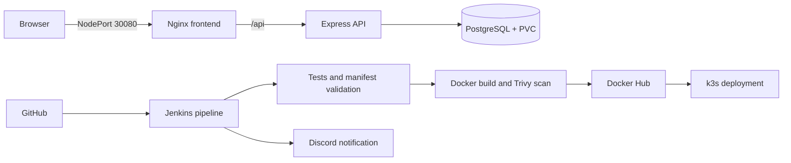

# Three-Tier k3s CI/CD Project

A small three-tier task application used to demonstrate a complete Jenkins delivery pipeline to a lightweight Kubernetes cluster.

The application is intentionally simple. The main focus is the path from a Git commit to tested, scanned, immutable container images running on k3s.

## Architecture



The Kubernetes deployment runs two frontend and two backend replicas. Horizontal Pod Autoscalers can scale each tier from two to five replicas using CPU utilization. PostgreSQL uses a persistent volume claim and remains a single instance for this demonstration.

## Pipeline

[`Jenkinsfile`](Jenkinsfile) defines these stages:

1. Check out the revision that triggered the job and derive an immutable image tag from its Git SHA.
2. Install locked dependencies, run syntax checks and API tests, and audit production dependencies.
3. validate Docker Compose and render the Kubernetes Kustomize configuration.
4. Build both container images and label them with the Git revision.
5. Fail on unfixed high or critical image vulnerabilities reported by Trivy.
6. On `main`, push the images to Docker Hub and deploy them to k3s.
7. Wait for both Kubernetes rollouts and send the final result to Discord.

The pipeline never suppresses deployment failures. Feature branches run validation and image builds but do not push or deploy.

## Repository layout

```text
.
├── backend/             Express API, tests, and container image
├── frontend/            Static UI and unprivileged Nginx image
├── k3s/                 Kustomize-ready Kubernetes resources
├── docker-compose.yml   Local three-tier environment
└── Jenkinsfile          CI/CD pipeline
```

## Run locally

Requirements: Docker with the Compose plugin.

```bash
cp .env.example .env
# Change POSTGRES_PASSWORD in .env.
docker compose up --build
```

Open <http://localhost:8080>. The PostgreSQL volume survives container recreation. Remove it only when you intentionally want to reset local data:

```bash
docker compose down --volumes
```

## Run the backend checks

Node.js 20 or newer is required.

```bash
cd backend
npm ci
npm run lint
npm test
npm audit --omit=dev --audit-level=high
```

The tests exercise the health endpoints, request validation, and parameterized task creation without requiring a live database.

## Deploy to k3s manually

Requirements: a k3s cluster, `kubectl`, a default storage class, and Metrics Server for the HPAs.

Create the namespace and database secret outside Git:

```bash
kubectl apply -f k3s/namespace.yaml
kubectl create secret generic postgres-secret \
  --namespace todo-app \
  --from-literal=POSTGRES_USER=postgres \
  --from-literal=POSTGRES_PASSWORD='replace-with-a-strong-password' \
  --from-literal=POSTGRES_DB=todoapp
```

Then apply the resources:

```bash
kubectl apply -k k3s
kubectl rollout status deployment/backend -n todo-app --timeout=180s
kubectl rollout status deployment/frontend -n todo-app --timeout=180s
```

Open `http://<node-ip>:30080`. [`k3s/postgres-secret.example.yaml`](k3s/postgres-secret.example.yaml) documents the expected Secret keys but is deliberately excluded from the Kustomize resources.

## Jenkins requirements

The Linux Jenkins agent needs:

- Node.js 20+
- Docker Engine and the Docker Compose plugin
- `kubectl` with Kustomize support
- Trivy

Install the Jenkins Credentials Binding and Discord Notifier plugins, then create these Jenkins credentials:

| Credential ID | Type | Purpose |
| --- | --- | --- |
| `dockerhub-creds` | Username and password | Push images to Docker Hub |
| `kubeconfig` | Secret file | Access the target k3s cluster |
| `discord-webhook-url` | Secret text | Send final build notifications |

Create `postgres-secret` in the target namespace before the first pipeline deployment. The pipeline verifies that it exists and fails rather than silently deploying with a default password.

## Security and production notes

- Runtime credentials are not stored in the repository.
- Jenkins credentials are scoped only to the steps that need them.
- Application containers run as non-root with dropped Linux capabilities.
- Kubernetes readiness and liveness probes control traffic and restarts.
- CPU and memory requests and limits are defined for every workload.
- Images produced by Jenkins use the Git SHA instead of a mutable `latest` tag.

This remains a learning project rather than a production database design. A real production deployment should use a managed or highly available PostgreSQL service, TLS ingress, backups, NetworkPolicies supported by the cluster CNI, and an external secret manager.

## License

[MIT](LICENSE)
